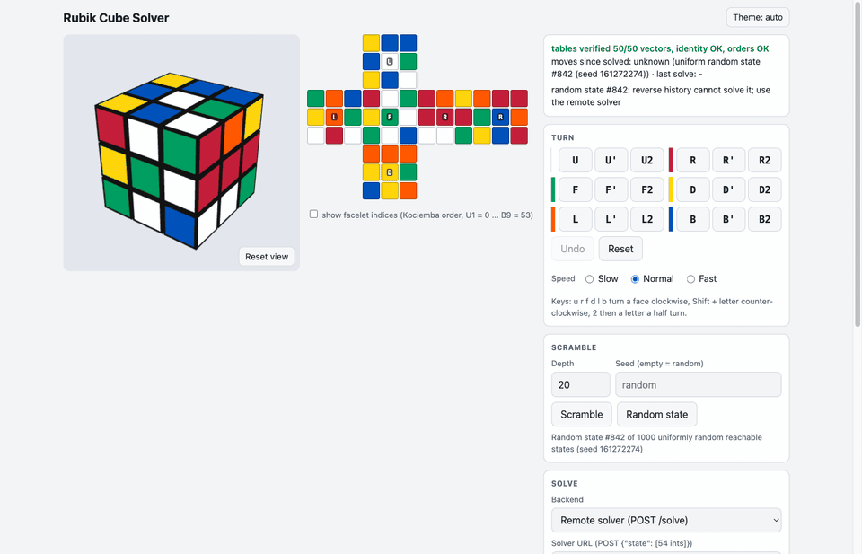

# rubiks-nn-app

A web page that solves the 3x3x3 Rubik's Cube with a small neural network. You scramble a 3D cube in the browser,
press **Solve**, and a trained policy network guides a beam search to a move sequence that solves the cube. The
page then animates it. The network was trained only on random scrambles of the solved cube, with no hand-written
solving knowledge: for each scrambled state it predicts the move that undoes the last scramble move.

Live demo:

- <https://cube.dovada.org>: the Docker image behind a reverse proxy. Pick **Remote solver (POST /solve)** to
  solve on that server.
- <https://alexandrumutescul.github.io/rubiks-nn-app/>: a static copy on GitHub Pages that solves in the browser.
  Pick **Neural network (ONNX, in the browser)**.



*A uniformly random state, solved with the Remote solver: the server's verified 31-move solution, animated on the page.*

This repository contains the serving code, the web page and the trained weights. Everything runs on a CPU inside
one Docker container. At the default beam width of 1024 the network solved 100% of 1,000 uniformly random cubes,
with 26.4 moves on average, in about 130 ms per cube on an Apple M4 Max CPU. The solutions are not optimal (an
optimal solver never needs more than 20 moves). Every solution is checked three times (by the search, by the server
and by the page) before it is shown.

## Quick start

You need Docker: Docker Desktop on macOS and Windows, Docker Engine on Linux.

### 1. One command (published image)

```
docker run --rm --name rubiks-nn-app --label app=rubiks-nn-app -p 8765:8765 ghcr.io/alexandrumutescul/rubiks-nn-app:latest
```

Open <http://localhost:8765/> and press Ctrl-C to stop. If port 8765 is taken, change the number on the left, e.g.
`-p 8766:8765`, and open <http://localhost:8766/> instead. The name and the label let `run.sh` and `run.ps1` see
that this copy is running, so they print its address instead of starting a second one. If Docker says that the name
is already in use, the app is already running; `docker stop rubiks-nn-app` stops it.

### 2. `./run.sh` (picks a free port for you)

```
git clone https://github.com/alexandrumutescul/rubiks-nn-app.git
cd rubiks-nn-app
./run.sh            # build the image here, start it on the first free port from 8765 to 8800
./run.sh --open     # the same, then open the page in the browser
./run.sh stop       # stop it
```

`run.sh` (macOS, Linux):

1. builds the image from this directory (`docker build -t rubiks-nn-app .`; cached after the first time), or pulls
   the published one with `--image ghcr.io/alexandrumutescul/rubiks-nn-app:latest`;
2. checks ports 8765 to 8800 and takes the first free one;
3. creates and starts the container (`docker create --rm --name rubiks-nn-app --label app=rubiks-nn-app
   -p <port>:8765 ...`, then `docker start`). If Docker still reports the port as taken, it removes the container it
   has just created and moves on to the next port;
4. waits up to 60 s for `GET /solver` to answer. Then the container's own Python sends a test cube one turn from
   solved (`R`) to `POST /solve`, and, when `--max-depth` is 6 or more, a second one six moves from solved. The
   start counts as a success only if the first answer comes back `"verified": true`. Otherwise `run.sh` exits with
   an error and leaves the container running, so that `docker logs rubiks-nn-app` shows what happened. If a small
   `--beam` leaves the second cube unsolved, `run.sh` only warns;
5. prints `open http://localhost:<port>/`.

If the app is already running, `run.sh` prints its address and does not start a second copy. It finds the app's
container by the name `rubiks-nn-app` or the label `app=rubiks-nn-app`, so a copy started with the `docker run`
command above or with Docker Compose counts too.

| option | default | meaning |
|---|---|---|
| `--image IMAGE` | build locally | use this image instead of building one |
| `--port N` | `$PORT` or 8765 | first port to try (N to N+35 are tried) |
| `--beam N` | `$BEAM` or 1024 | beam width of the search |
| `--max-depth N` | `$MAX_DEPTH` or 40 | longest solution the search tries |
| `--open` | off | open the page in the default browser |

On Windows, `run.ps1` does the same in PowerShell:

```
.\run.ps1
.\run.ps1 -Open -Image ghcr.io/alexandrumutescul/rubiks-nn-app:latest -Beam 1024 -Port 8765
.\run.ps1 stop
```

If the execution policy blocks the script, run `powershell -ExecutionPolicy Bypass -File .\run.ps1`.

### 3. Docker Compose

```
docker compose up              # builds the image on first use; open http://localhost:8765/
PORT=9000 docker compose up -d # another host port, in the background
docker compose down
```

Compose does not look for a free port. Set `PORT` yourself, or use `run.sh`. Compose gives the container the same
name and label, so `run.sh` and `run.ps1` find it and print its address instead of starting a second copy.

## Without Docker

You need Python 3.12 or newer.

```
python3 -m venv .venv
source .venv/bin/activate                  # Windows: .venv\Scripts\activate
pip install -e .
python -m rubiks.serve --web web --backend policy --checkpoint models/policy-v2.pt --beam 1024 --device cpu
```

Then open <http://localhost:8765/>.

- On Linux without a GPU, run `pip install torch --index-url https://download.pytorch.org/whl/cpu` before
  `pip install -e .`. Otherwise pip downloads the much larger CUDA build of PyTorch.
- `--device auto` uses a GPU when there is one (CUDA, or Apple's MPS).
- `--host 0.0.0.0` makes the server reachable from a phone on the same network.
- `rubiks-nn-serve` is an installed alias for `python -m rubiks.serve`, and `python -m rubiks.serve --help` lists
  every flag.
- To run the tests: `pip install -e ".[dev]"`, then `python -m pytest`.
- The optional `pip install -e ".[kociemba]"` installs the two-phase solver package. With it, the server falls
  back to the two-phase solver when the beam search finds no solution within its limits (`--fallback kociemba`,
  the default outside Docker). The Docker image runs without a fallback.

## Using the app

1. **Scramble the cube.** **Scramble** makes a random walk of the given depth (default 20; a seed makes it
   repeatable). **Random state** loads one of 1,000 uniformly random reachable states that ship with the page. You
   can also turn faces with the buttons or the keyboard (`u r f d l b`; Shift + letter turns counter-clockwise, and
   `2` then a letter turns a half turn). You can also type a sequence such as `R U R' U'`, or paste a 54-letter
   facelet string and press **Load**.
2. **Pick the solver.** In the **Solve** panel, set **Backend** to **Remote solver (POST /solve)**. The page
   remembers this choice. The solver URL fills itself in when the page comes from the app. The default backend,
   *Reverse history*, only undoes the moves made on the page, so it cannot solve a Random state.
3. **Press Solve.** The page applies the answer to its own copy of the cube before it animates anything. The
   status line then shows, for example, `last solve: remote: policy-beam, 26 moves, 140 ms (server 130 ms),
   verified`: who solved it, the solution length, the time the page waited, the time the server spent searching,
   and whether the moves really solve the cube. If an answer does not solve the cube, the page says
   `DOES NOT SOLVE` and offers **Animate anyway**. Wrong answers are never hidden.

**Stop** cancels a running solve. The page also works on a phone: open `http://<this computer's IP>:<port>/`
from a phone on the same network.

### In-browser solver

The page can also solve with no server at all: **try it on GitHub Pages at
<https://alexandrumutescul.github.io/rubiks-nn-app/>**. Set **Backend** to **Neural network (ONNX, in the
browser)**. The page then runs the same network, `models/policy-v2.onnx`, inside the browser with ONNX Runtime Web
1.20.1, which it loads from cdnjs on first use. `web/search.js` is the beam search of `rubiks/search.py` written in
JavaScript: the same move filter, scores, duplicate removal and tie-breaking, the same check for a solved state
before the beam is cut, one network call per depth over the whole beam, and at most 40 moves.

- **Beam width** is set under the backend, from 64 to 4096 (default 1024). A wider beam finds shorter solutions and
  takes longer. A progress line shows each depth, and **Stop** cancels between depths.
- The status line reads `last solve: onnx: policy-v2 (beam 1024), <n> moves, <t> ms, <nodes> nodes, verified`. As
  with the server, the page checks the moves with its own tables before it animates them.
- The page must come from a web server, because under `file://` the browser cannot load the model. The Docker image
  has the model next to the page (`web/model/policy-v2.onnx`), so this backend also works at the app's own address,
  `http://localhost:<port>/`. With `python -m rubiks.serve --web web`, copy the model next to the page first:
  `mkdir -p web/model && cp models/policy-v2.onnx web/model/`. [web/model/README.md](web/model/README.md) gives the
  order in which the page looks for the model.
- ONNX Runtime runs single-threaded here, because GitHub Pages does not send the headers that WebAssembly threads
  need.
- **Parity check.** `tests/test_web_search_parity.py` writes `tests/data/web-parity.json`, 70 cases solved by the
  Python search (20 scrambles with the ONNX model and 11 with an exact synthetic policy that forces score ties), and
  checks that the Python search still gives the same answers. `web/search-test.html` runs the same cases through
  `web/search.js` in a browser. To run it locally, start a server from the repository root and open the harness
  (it needs internet access for ONNX Runtime Web):

  ```
  python -m rubiks.serve --port 8777 --host 127.0.0.1 --web . --backend none
  # then open http://127.0.0.1:8777/web/search-test.html in a browser
  ```

  When every case matches, the page title becomes `PARITY 70/70 PASS`. It passed 70/70 in Chrome with ONNX Runtime
  Web 1.20.1: the model loaded in 625 ms, and the network's 18 logits for each case's start state were within 3.3e-6
  of those from `onnxruntime` in Python.

### API

The server that serves the page also answers two endpoints.

`GET /solver` describes the solver that answers `/solve`. In the container it returns:

```
{"backend": "policy", "checkpoint": "/app/models/policy-v2.pt", "beam": 1024, "max_depth": 40, "device": "cpu", "fallback": "none"}
```

`POST /solve` takes `{"state": [54 ints]}` and returns a solution. Here it solves the cube after `R U F' L2 D B'`:

```
curl -s http://localhost:8765/solve -H 'Content-Type: application/json' \
  -d '{"state": [0,2,2,3,0,0,3,1,1,5,5,3,3,1,0,4,2,0,5,3,3,5,2,2,2,2,2,0,0,0,3,3,4,2,1,5,5,4,4,5,4,4,4,5,1,1,1,1,4,5,1,4,0,3]}'
```

```
{"moves": [15, 10, 14, 6, 1, 4], "solver": "policy-beam", "ms": 21.0, "verified": true, "nodes": 3334, "notation": "B D' L2 F U' R'"}
```

The fields mean:

- `state` holds 54 colours (0 to 5) in Kociemba's facelet order. The faces are U R F D L B, and
  `facelet = face*9 + row*3 + col`. A solved cube has colour `i // 9` at facelet `i`.
- `moves` are indices into `U U' U2 R R' R2 F F' F2 D D' D2 L L' L2 B B' B2`.
- `notation` is the same solution written out as moves.
- `ms` is the server's search time.
- `nodes` is the number of states the network scored.
- `verified` is the server's own check that the moves solve the state.

The server rejects bad requests:

- 400: the state is malformed or cannot be reached by turning a cube (the message gives the reason).
- 413: the request body is too large.
- 500: the search found no solution within its limits.

## Configuration

| setting | default | meaning |
|---|---|---|
| `BEAM` | 1024 | beam width. More states are kept per step, so solutions get shorter and solves get slower |
| `MAX_DEPTH` | 40 | longest solution the search tries, in moves |
| `PORT` | 8765 | host port for `docker compose`; first port tried by `run.sh` |
| `CHECKPOINT` | `/app/models/policy-v2.pt` | checkpoint inside the container (mount your own with `-v`) |

How to set them:

```
docker run --rm --name rubiks-nn-app --label app=rubiks-nn-app -p 8765:8765 -e BEAM=256 ghcr.io/alexandrumutescul/rubiks-nn-app:latest
./run.sh --beam 256
BEAM=4096 docker compose up
```

Measured CPU times per random cube (Apple M4 Max): about **130 ms at beam 1024** and **73 ms at beam 256**. Inside
the Docker container on the same machine, a random cube took about 190 ms at beam 1024. Beam
4096 finds the shortest solutions and takes about 100 ms on an Apple GPU, but it is slower on a CPU. Beam 256
leaves about 13% of random cubes unsolved; the server answers those with an error. The page waits at most 20 s for
an answer.

## What was done

- **Cube model:** a 54-sticker model of the cube with the 18 half-turn moves, checked against a second,
  independent cubie-level model.
- **Training data:** random scrambles of depth 1 to 20 from the solved cube. The label is the inverse of the last
  scramble move.
- **Network:** an MLP (324 → 1024 → 512 → 18, LayerNorm, ReLU, 869,906 parameters). It was trained for 12 epochs
  on 10 million scrambles, which took 203 s. Its next-move top-1 accuracy is 46.2% on validation.
- **Search:** a batched beam search ranks move sequences by the network's cumulative log-probability. It stops at
  the first depth that contains the solved cube.
- **Web app:** plain HTML and JavaScript (three.js r128 from cdnjs, no build step). It talks to a small Python
  server.

The details are in [docs/WHAT-WAS-DONE.md](docs/WHAT-WAS-DONE.md).

## Results

The test set is 1,000 uniformly random cube states:

| search | solved | mean solution length |
|---|---|---|
| greedy (the network's top move at every step, up to 40 moves) | 0% | - |
| beam 256 | 87% | 29.8 moves |
| beam 1024 (default) | **100%** | 26.4 moves |
| beam 4096 | **100%** | **23.8 moves** |

The first model (v1), trained on 1M rows, solved 96% with 29.5 moves at beam 4096. The model shipped here (v2),
trained on 10M rows, solves 100% with 23.8 moves.

## Repository layout

```
rubiks/              the Python package
  cube.py            54-sticker cube model; the 18 moves as permutations derived from 3D geometry
  cubie.py           cubie-level model (corner/edge permutation and orientation), the independent cross-check
  sampling.py        random scrambles and uniformly random states
  data.py            one-hot encoding (54 x 6 = 324 inputs) and the training label
  model.py           the MLP; checkpoint save / load
  search.py          batched beam search and the greedy baseline
  solver_nn.py       NNSolver: loads a checkpoint, runs the search, re-checks the answer
  serve.py           HTTP server: the page, GET /solver, POST /solve
  export_web.py      regenerates web/cube-tables.js from the Python model
web/                 the page (see web/README.md)
  index.html         the page and its CSS
  app.js             the 3D view, the 2D net, the move queue, the controls and the solver wiring
  solver.js          cube logic from the tables; the solver backends (remote, in-browser ONNX)
  search.js          the beam search of search.py in JavaScript, for the in-browser solver
  search-test.html   parity harness: search.js against the Python search (tests/data/web-parity.json)
  cube-tables.js     generated by export_web.py
  model/             where the in-browser solver also looks for policy-v2.onnx (see web/model/README.md)
models/              the trained weights (see models/README.md)
tests/               pytest suite; tests/data/web-parity.json is the parity fixture
docs/                WHAT-WAS-DONE.md, demo.gif
Dockerfile, .dockerignore, compose.yaml, run.sh, run.ps1, .github/workflows/ (ci.yml, pages.yml)
LICENSE, CITATION.cff
```

## Limits

- **Solutions are not optimal.** They average 26.4 moves at the default beam, while an optimal solver needs at most
  20.
- **Small beams can fail.** At beam 256 about 13% of random cubes are not solved within the move limit. The server
  then answers 500 with the reason, because the image has no fallback solver.
- **CPU only.** The image does not use a GPU, so larger beams are noticeably slower in it.
- **The in-browser solver needs the model next to the page, and internet access the first time.** The page's
  *Neural network (ONNX, in the browser)* backend works from the Docker image, from the GitHub Pages site, or from
  any server that has `policy-v2.onnx` where the page looks for it ([web/model/README.md](web/model/README.md)). It
  does not work from a `file://` page. It loads ONNX Runtime Web 1.20.1 from cdnjs on first use; after that the
  browser normally has it in its cache.
- **Development-grade server.** It is meant for a laptop or a local network, not the open internet. Docker
  publishes the port on every network interface; use `-p 127.0.0.1:8765:8765` to keep the app private to your
  computer.
- **The 3D view needs internet access.** three.js loads from cdnjs. Offline, the page shows the 2D net instead, and
  all controls still work.
- **The image is large.** The CPU build of PyTorch alone takes about 555 MB.
- **Training code is not included.** The training script and the dataset generator's command-line tool are not
  part of this repository; it holds what is needed to run and check the trained model.

## License

License: MIT (see LICENSE).
